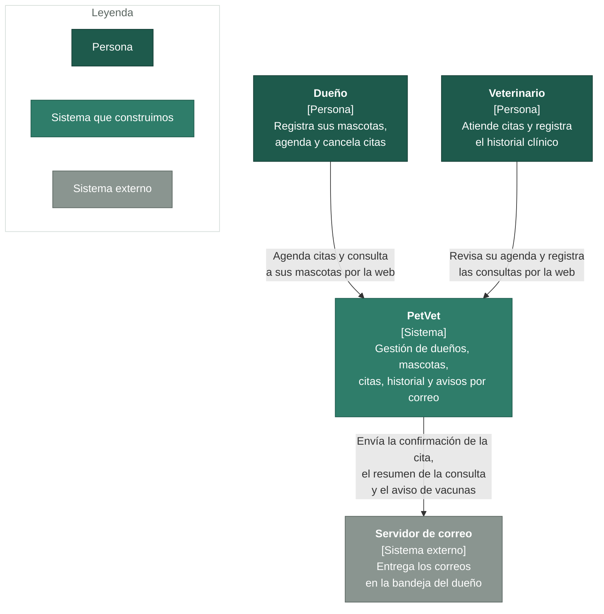
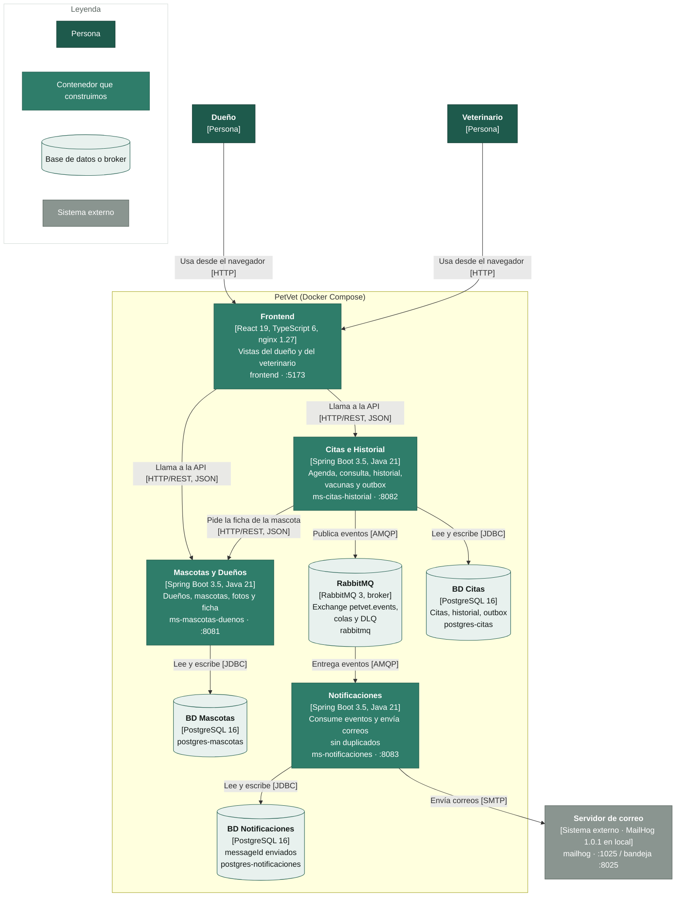

# Arquitectura de PetVet

Resumen de la arquitectura: estilos, diagramas C4 de contexto y de contenedores, atributos de calidad y los trade-offs de las decisiones principales. Cada decisión tiene su ADR en [adr/](adr/README.md). Los requerimientos están en [Requerimientos](requerimientos.md) y los patrones y SOLID con enlaces al código en [Sustentación del backend](sustentacion-backend.md).

## Estilos arquitectónicos

PetVet combina tres estilos, cada uno en un nivel distinto.

| Estilo | Dónde se ve | Por qué |
| --- | --- | --- |
| **Microservicios orientados a eventos** | Tres servicios con su propia base: Mascotas y Dueños, Citas e Historial, y Notificaciones. Citas publica `cita.agendada`, `cita.completada` y `vacuna.proxima` en RabbitMQ y Notificaciones los consume. | Cada parte del dominio cambia, se prueba y falla por separado. Los correos no frenan el agendamiento. [ADR-001](adr/ADR-001-microservicios.md), [ADR-003](adr/ADR-003-rabbitmq-para-notificaciones.md) |
| **Capas con puertos y adaptadores (Clean Architecture)** | Dentro de cada servicio: `presentation` (controladores REST), `application` (casos de uso), `domain` (reglas y puertos, Java sin Spring) e `infrastructure` (JPA, REST, RabbitMQ, SMTP). Las dependencias apuntan hacia el dominio. | Las reglas del negocio no dependen de la base, del broker ni del correo. Cambiar un adaptador no toca el dominio. [ADR-006](adr/ADR-006-clean-architecture-por-servicio.md) |
| **Cliente-servidor** | El navegador ejecuta el frontend (React) y llama por HTTP/JSON a Mascotas y Dueños y a Citas e Historial. | El front solo muestra y captura; las reglas viven en el back. [ADR-008](adr/ADR-008-spa-react-con-capa-api.md) |

**¿Y MVC?** No es el estilo del sistema. En el back, los controladores de Spring cumplen el papel del controlador, pero solo traducen HTTP y delegan en los casos de uso; no hay vistas en el servidor. En el front, las pantallas están separadas por funcionalidad (`features/`): la vista arma la pantalla, los hooks manejan el estado del servidor con TanStack Query y `src/api` hace las llamadas. Es una separación en capas, no MVC clásico.

## C4 nivel 1: contexto

Pensado para alguien no técnico: muestra quién usa PetVet y con qué otro sistema se comunica, sin detalles de tecnología.

Las flechas indican quién inicia la comunicación y para qué.

## C4 nivel 2: contenedores

Cada contenedor muestra debajo el nombre de su servicio en `docker-compose.yml` y su puerto, así que el diagrama se puede comparar uno a uno con el Compose. Notificaciones no expone rutas al frontend: solo recibe eventos. El frontend nunca habla con RabbitMQ ni con las bases. En el Compose, cada base está en una red que solo ve su servicio, y RabbitMQ en una red que solo ven Citas y Notificaciones.

Los dos diagramas están también como imagen para el informe y las diapositivas: [contexto](img/c4-contexto.png) y [contenedores](img/c4-contenedores.png).

## Atributos de calidad

| Atributo | Táctica en la arquitectura | Evidencia |
| --- | --- | --- |
| **Disponibilidad** | Comunicación asíncrona con RabbitMQ y patrón outbox: la cita y su evento se guardan en la misma transacción y un despachador reintenta hasta que el broker confirma. En el front, cada sección carga por separado y un servicio caído solo afecta su parte de la pantalla. | P11 y P12 en vivo. `OutboxRabbitIT` |
| **Consistencia** | Restricciones de exclusión en PostgreSQL sobre el intervalo de cada cita, por veterinario y por mascota. El servicio valida antes para dar un mensaje claro, pero la base es la garantía. | P6, P7. `CitasApiIT` con reservas simultáneas |
| **Confiabilidad** | Entrega al menos una vez con `messageId` único: Notificaciones lo registra en la misma transacción del envío y descarta repetidos. Reintentos con espera creciente y DLQ. | `NotificacionesRabbitIT` |
| **Mantenibilidad** | Capas con puertos y adaptadores en cada servicio. En el front, vistas, hooks y `src/api` separados; el front depende solo de los contratos de `types.ts`. | El front se construyó con mocks y pasó a la API real cambiando una variable de entorno |
| **Extensibilidad** | Strategy para los esquemas de vacunación (OCP). Especies y tipos de servicio en listas únicas. | `SelectorEsquemaVacunacion`, `VacunacionStrategyTest` |
| **Usabilidad** | Errores con un formato único `{error, detalle}` y el detalle en español, que el front muestra tal cual. Estados de carga, vacío y error en cada vista. | P3, P6, P7 |

## Trade-offs

Cada decisión mejora un atributo a cambio de otro. Estos son los principales; el detalle está en cada ADR.

| Decisión | Ganamos | Pagamos | ADR |
| --- | --- | --- | --- |
| Microservicios en vez de monolito | Cada servicio cambia, se prueba y falla por separado | Más infraestructura, red entre servicios y más difícil de probar de punta a punta | [ADR-001](adr/ADR-001-microservicios.md) |
| Una base por servicio | Cada servicio es dueño de sus datos | No hay consultas ni transacciones entre bases; Citas pide la ficha por REST | [ADR-002](adr/ADR-002-base-de-datos-por-servicio.md) |
| Notificaciones por eventos en RabbitMQ | Agendar no depende del correo (disponibilidad) | El correo llega segundos después (consistencia eventual) y hay un componente más que operar | [ADR-003](adr/ADR-003-rabbitmq-para-notificaciones.md) |
| Outbox para publicar | Ningún evento se pierde aunque el broker esté caído | Un evento puede llegar repetido: hace falta deduplicar por `messageId` | [ADR-004](adr/ADR-004-outbox-y-entrega-al-menos-una-vez.md) |
| REST síncrono de Citas a Mascotas | Simple y siempre con los datos actuales de la mascota | Si Mascotas cae, no se puede agendar (`503`) | [ADR-005](adr/ADR-005-rest-sincrono-citas-a-mascotas.md) |
| Clean Architecture en cada servicio | Dominio aislado, fácil de probar y de cambiar | Más clases e interfaces para operaciones sencillas | [ADR-006](adr/ADR-006-clean-architecture-por-servicio.md) |
| Choques de horario en PostgreSQL | Correcto con reservas simultáneas | Atado a una característica de PostgreSQL (restricción de exclusión) | [ADR-007](adr/ADR-007-choques-de-horario-en-postgresql.md) |
| SPA con capa `src/api` y mocks | El front avanzó sin esperar al back | Hay que mantener los mocks iguales al contrato real | [ADR-008](adr/ADR-008-spa-react-con-capa-api.md) |
| Perfil simulado sin login | Tiempo para la arquitectura y el dominio | Sin seguridad: cualquiera puede entrar como cualquier dueño | [ADR-009](adr/ADR-009-perfil-simulado-sin-login.md) |
| Gitflow con ramas protegidas | `main` siempre estable y cada cambio revisado | Más pasos por cambio y ramas que se desactualizan | [ADR-010](adr/ADR-010-gitflow-y-conventional-commits.md) |
| Migraciones con Flyway | Esquema versionado e igual en todos los equipos | Una migración aplicada no se edita: cada corrección es otra migración | [ADR-011](adr/ADR-011-migraciones-con-flyway.md) |
| Errores en un manejador central | Un solo formato `{error, detalle}` que el front muestra tal cual | Tres manejadores que mantener alineados | [ADR-012](adr/ADR-012-manejo-de-errores-centralizado.md) |
| Docker Compose en local | Un comando levanta todo con las mismas versiones | Primera construcción lenta y consumo de memoria | [ADR-013](adr/ADR-013-docker-compose-para-desarrollo-local.md) |
| Integración con Testcontainers | Las reglas críticas se prueban contra PostgreSQL y RabbitMQ reales | Pruebas más lentas que necesitan Docker | [ADR-014](adr/ADR-014-estrategia-de-pruebas.md) |
