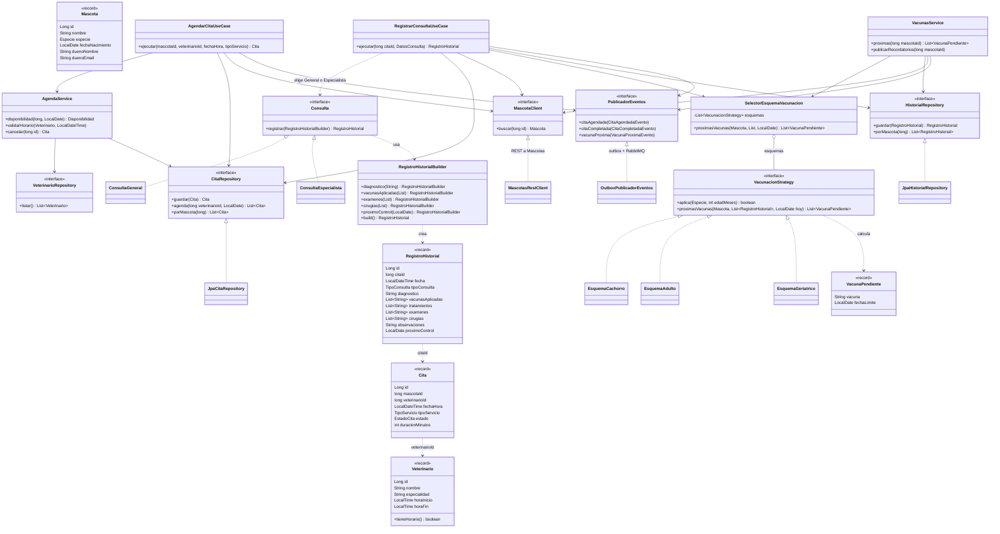
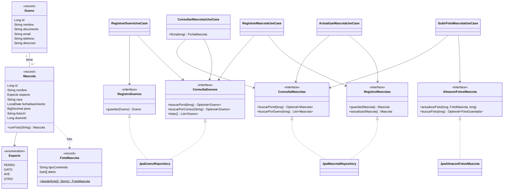
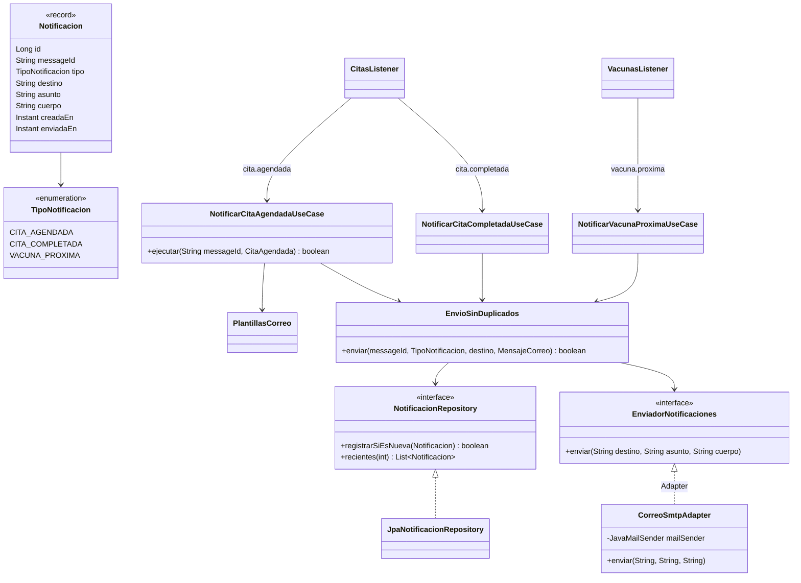

# Diagrama de clases UML

Diseño final implementado, un diagrama por servicio. Muestra las clases del dominio, los casos de uso, los puertos (interfaces del dominio) y los adaptadores de infraestructura que los implementan. Se omiten los controladores REST, los DTO y las entidades JPA, que solo traducen datos. Los patrones de cada diagrama están explicados con su código en [Sustentación del backend](sustentacion-backend.md).

Cómo leerlos: `<<interface>>` es un puerto del dominio; la flecha punteada con triángulo (`..|>`) significa "implementa"; la flecha continua (`-->`) significa "usa"; el rombo (`*--`) es composición. Los servicios no comparten clases: cada uno tiene su propia `Mascota` o `Especie` con solo los datos que necesita (base por servicio, [ADR-002](adr/ADR-002-base-de-datos-por-servicio.md)).

## Citas e Historial

Aquí están los dos patrones principales: **Builder** (`RegistroHistorialBuilder`) para armar el historial de una consulta y **Strategy** (`VacunacionStrategy`) para los esquemas de vacunación. Los puertos `MascotaClient` y `PublicadorEventos` son la inversión de dependencias: el dominio define la interfaz y la infraestructura la implementa con REST y con la outbox.

## Mascotas y Dueños

Aplica **segregación de interfaces (ISP)**: leer y escribir están en puertos separados (`ConsultaMascotas` y `RegistroMascotas`, `ConsultaDuenos` y `RegistroDuenos`), así cada caso de uso depende solo de lo que usa.

## Notificaciones

Aplica **Adapter**: los casos de uso envían por el puerto `EnviadorNotificaciones` y `CorreoSmtpAdapter` lo concreta con SMTP. `EnvioSinDuplicados` registra el `messageId` antes de enviar, así un evento repetido no genera otro correo.

Las imágenes para el informe están en [img/](img/): `clases-citas.png`, `clases-mascotas.png` y `clases-notificaciones.png`.

