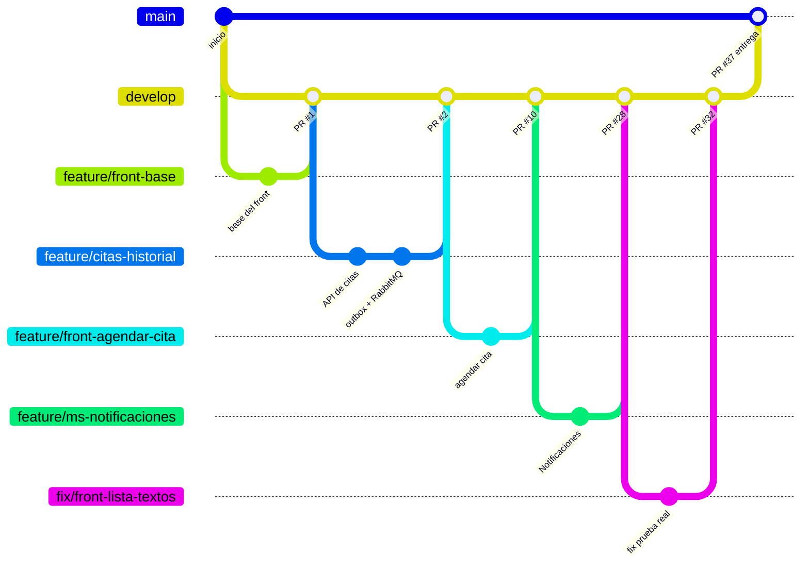

# Flujo de trabajo con Git

Cómo trabajó el equipo en el repositorio https://github.com/CamiloGutierrez1/petvet. La decisión y sus alternativas están en [ADR-010](adr/ADR-010-gitflow-y-conventional-commits.md). Las cifras de este documento salen del historial de Git y de la API de GitHub, consultadas el 20 de noviembre de 2026.

## Estrategia de ramas: Gitflow simplificado

| Rama | Para qué | Quién escribe en ella |
| --- | --- | --- |
| `main` | Versión entregable. Recibe `develop` solo cuando todo está probado. | Nadie directo: solo el pull request de entrega (#37) |
| `develop` | Integración del día a día y rama por defecto del repositorio. | Nadie directo: solo pull requests |
| `feature/<servicio>-<tarea>` | Una funcionalidad. Sale de `develop` y vuelve a `develop`. | Su autor |
| `fix/<servicio>-<tarea>` | Corrección de un error encontrado al probar. | Su autor |

`main` y `develop` están protegidas en GitHub: no aceptan push directo y todo entra por pull request. No usamos ramas `release/…` ni `hotfix/…`: con una sola entrega, el pull request de `develop` a `main` cumple el papel del release, y no hubo errores en `main` que corregir.

El diagrama muestra 5 de las 37 ramas como ejemplo; la imagen está en [img/git-ramas.png](img/git-ramas.png).

## Convención de nombres de ramas

`feature/` o `fix/`, seguido del servicio (`front`, `citas`, `ms-…`, `docs`) y la tarea en minúsculas con guiones. Ramas reales del repositorio:

- `feature/front-base`, `feature/front-agendar-cita`, `feature/front-agenda-veterinario`
- `feature/citas-historial`, `feature/citas-cirugias-horarios-examenes`
- `feature/ms-mascotas-duenos`, `feature/ms-notificaciones`
- `feature/docs-arquitectura`, `feature/entrega-final`
- `fix/front-lista-textos`

## Convención de commits: Conventional Commits

`tipo(alcance): descripción en español, en presente`. Tipos: `feat` (funcionalidad), `fix` (corrección), `docs`, `chore` (configuración o infraestructura), `test` y `perf`. En todo el repositorio hay 41 `feat`, 13 `fix`, 11 `chore`, 10 `docs`, 5 `test` y 1 `perf`; unos pocos commits no siguieron la convención (por ejemplo, empiezan con `mascotas:` sin tipo). El alcance es el servicio. Commits reales:

- `feat(citas): agrega publicación de eventos con outbox y RabbitMQ`
- `feat(mascotas): registro y consulta de dueños y mascotas con la ficha plana que consume Citas`
- `fix(mascotas): el peso admite tres decimales, como los 0.035 kg de un periquito`
- `chore(infra): agrega Docker Compose con PostgreSQL, RabbitMQ y MailHog`
- `docs: requerimientos, arquitectura con C4 y ADR`

## Proceso de pull requests

1. El autor crea su rama desde `develop` actualizado y abre el pull request hacia `develop` con una descripción de qué cambia.
2. **Revisión:** Camilo, como coordinador, revisa los pull requests de los demás. Descarga la rama, comprueba que no tenga conflictos con `develop` (`git merge-tree`), lee el diff y la prueba en local contra los otros servicios.
3. **Criterios para aprobar:** compila y pasan las pruebas del módulo, respeta el contrato de `docs/api.md`, no rompe otra pantalla u otro servicio y sigue la convención de commits.
4. Si cumple, se hace merge con merge commit y se borra la rama. Si no, se pide el cambio o se cierra con la razón. Así se cerraron los 5 pull requests de Pia: tres (#23, #24 y #26) eran intentos del servicio de Mascotas y Dueños, que Jersson asumió y entregó completo con sus pruebas en el #27, y dos (#33 y #34) traían archivos del front en JavaScript (`.js` y `.jsx`) que duplicaban pantallas ya existentes en TypeScript.
5. Los pull requests de Camilo los integra él mismo como líder, con la opción "bypass" de GitHub. Esto es una debilidad del proceso y está en las [lecciones aprendidas](lecciones-aprendidas.md).

**Issues:** no usamos GitHub Issues. Las tareas se repartieron en un plan por días acordado en el grupo, y cada pull request describe la tarea que cierra.

## Métricas de participación

| Integrante | Commits en `develop` | Pull requests creados | Pull requests integrados | Pull requests revisados | Principales áreas de contribución |
| --- | --- | --- | --- | --- | --- |
| Jersson Mejía | 55 | 6 | 6 | 0 | Backend: los tres microservicios, outbox y RabbitMQ, Flyway, Docker Compose, pruebas de integración, documentación del back |
| Camilo Gutiérrez | 26 | 25 | 25 | 12 | Frontend completo (vistas del dueño y del veterinario), integración front-back, Docker del front, coordinación, documentación de arquitectura, C4 y ADR |
| Andrés Daza | 1 | 1 | 1 | 0 | Componentes compartidos del front (PR #4): tabla, estados vacío, error y carga, etiqueta de estado de cita. Rol de QA y demo en la sustentación |
| Pia | 0 (35 en ramas sin integrar) | 5 | 0 | 0 | Intentos del servicio de Mascotas y Dueños y archivos del front en JavaScript, cerrados sin merge |

Notas sobre la tabla:

- "Revisados" cuenta los pull requests de otros que Camilo revisó antes de integrarlos o cerrarlos: 6 de Jersson, 1 de Daza y 5 de Pia. En GitHub solo 2 quedaron con aprobación formal (#2 y #4) y uno con comentario (#23); los demás se revisaron en local.
- Commits sin contar los merges. Camilo tiene menos commits que pull requests porque varios pull requests suyos tienen uno o dos commits.

**Distribución en el tiempo** (commits en `develop`, sin merges): 10 nov: 17 · 11 nov: 7 · 12 nov: 14 · 13 nov: 37 · 14 nov: 6 · 16 nov: 1. El trabajo se repartió en una semana; el día de mayor carga fue el 13, cuando se integraron Mascotas y Notificaciones.

## Capturas

Las capturas del historial están en [img/](img/):

- `git-pull-requests.png`: lista de pull requests del repositorio.
- `git-commits.png`: historial de commits de `develop`.
